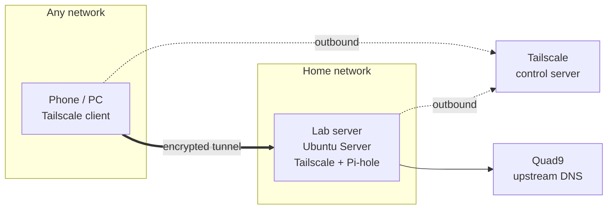

# Private DNS Filtering and Remote Access (Pi-hole + Tailscale)

A self-hosted home-lab service running on a repurposed laptop. It blocks ads, trackers and malicious domains for every enrolled device, and gives those devices private access to the home server from any network.


<!-- Add a hero screenshot, for example the Pi-hole dashboard. -->

---

## Features

- Network-level ad, tracker and malware blocking with Pi-hole
- Encrypted private access from anywhere with Tailscale (WireGuard-based)
- Works behind CGNAT, with no router port forwarding
- Optional full tunnel: pick the server as an exit node, or switch back to split tunnel
- Runs unattended: fixed LAN address, no sleep, all services start at boot

## Architecture



**How a lookup works**

1. A client asks the server (over the tunnel) for a domain's address.
2. Pi-hole checks its blocklist. If the domain is listed, it answers `0.0.0.0` and the ad never loads.
3. Otherwise Pi-hole asks Quad9 and returns the real answer.
4. The client then connects to the site directly.

**Split vs full tunnel**

| Mode | What goes through the server | How to switch |
|---|---|---|
| Split (default) | DNS and traffic between my own devices | Exit node: **None** |
| Full | All of the device's internet traffic | Exit node: choose the server |

## Tech stack

| Layer | Component |
|---|---|
| Hardware | Repurposed laptop (4 GB RAM) |
| OS | Ubuntu Server 26.04 LTS (headless, SSH) |
| DNS filter | Pi-hole v6 |
| Upstream DNS | Quad9 (filtered, DNSSEC) |
| Remote access | Tailscale |
| Optional | WireGuard server (`wg0`), kept as a manual reference setup |

---

## Setup

Run **Server** commands on the lab laptop (over SSH) and **PC** commands on your main computer. Replace `<placeholders>` with your own values.

### 1. Install the OS

1. On the PC, write the Ubuntu Server LTS ISO to a USB drive (Rufus or Ventoy).
2. Boot the server from the USB, install to the whole disk, and **enable OpenSSH**.
3. Give the server a fixed LAN address in your router (DHCP reservation).
4. Connect from the PC:

```bash
ssh <user>@<server-lan-ip>
```


### 2. Install Pi-hole

```bash
sudo apt update && sudo apt install -y curl dnsutils
curl -sSL https://install.pi-hole.net -o ~/pihole-install.sh
sudo bash ~/pihole-install.sh
sudo pihole setpassword
```

Installer choices: network interface = the one the server uses, upstream DNS = Quad9 (filtered, DNSSEC), default blocklist, web admin = yes, query logging = yes.

Test blocking:

```bash
dig @127.0.0.1 example.com        # a real address
dig @127.0.0.1 doubleclick.net    # 0.0.0.0 (blocked)
```


### 3. Install Tailscale

```bash
curl -fsSL https://tailscale.com/install.sh | sh
sudo tailscale up --accept-dns=false
tailscale ip -4                   # the server's 100.x address
```

In the Tailscale admin console:

1. **Machines:** disable key expiry for the server.
2. **DNS:** add a **Custom** nameserver with the server's `100.x` address and turn on **Override DNS servers**.
3. Turn on two-factor authentication for the account.

Let Pi-hole answer Tailscale clients:

```bash
sudo pihole-FTL --config dns.listeningMode all
```


### 4. Enroll devices

1. Install the Tailscale app on each device and sign in to the same account.
2. Android: set **Private DNS** to Off or Automatic. In Chrome, turn off **Use secure DNS**.
3. Windows: tick **Use Tailscale DNS settings** in Preferences, and turn off secure DNS in the browser.


### 5. Enable the exit node (optional full tunnel)

```bash
echo 'net.ipv4.ip_forward = 1' | sudo tee /etc/sysctl.d/99-tailscale.conf
echo 'net.ipv6.conf.all.forwarding = 1' | sudo tee -a /etc/sysctl.d/99-tailscale.conf
sudo sysctl -p /etc/sysctl.d/99-tailscale.conf
sudo tailscale set --advertise-exit-node
```

In the admin console, open the server's **Edit route settings** and tick **Use as exit node**. Then on each device choose **Exit node → server** for full tunnel, or **None** for split tunnel.


### 6. Keep it running 24/7

```bash
sudo mkdir -p /etc/systemd/logind.conf.d
printf "[Login]\nHandleLidSwitch=ignore\nHandleLidSwitchExternalPower=ignore\nHandleLidSwitchDocked=ignore\n" | sudo tee /etc/systemd/logind.conf.d/lid.conf
sudo systemctl kill -s HUP --kill-who=main systemd-logind
sudo systemctl mask sleep.target suspend.target hibernate.target hybrid-sleep.target
```

Shut down with `sudo shutdown now`. Services start again on the next boot.

### 7. Optional: manual WireGuard server

Kept as a reference for how the underlying VPN works. It has no peers.

```bash
sudo apt install -y wireguard
sudo sh -c "wg genkey | tee /etc/wireguard/server_private.key | wg pubkey > /etc/wireguard/server_public.key"
sudo chmod 600 /etc/wireguard/server_private.key
echo 'net.ipv4.ip_forward=1' | sudo tee /etc/sysctl.d/99-wireguard.conf && sudo sysctl --system
```

`/etc/wireguard/wg0.conf`:

```ini
[Interface]
Address = 10.20.20.1/24
ListenPort = 51820
PrivateKey = <server private key>
```

```bash
sudo chmod 600 /etc/wireguard/wg0.conf
sudo wg-quick up wg0
sudo systemctl enable wg-quick@wg0
```

---

## Verification

| Check | Result |
|---|---|
| Blocked domain returns `0.0.0.0` | Passed |
| Phone on mobile data appears in the Pi-hole Query Log | Passed |
| Blocked sites fail to load on the phone | Passed |
| PC reaches the server over Tailscale (SSH) | Passed |
| Exit node switches full tunnel on and off | Passed |
| Server keeps running with the lid closed | Passed |
| Services return after a cold boot | Passed |
| Latency (`tailscale ping`) | `<ms>` ms, `<direct / relayed>` |


### Packet capture

Capture inside the tunnel and on the network interface while a phone browses:

```bash
sudo apt install -y tcpdump
sudo timeout 90 tcpdump -Z $USER -i tailscale0 -n port 53 -w ~/inside-tunnel.pcap
sudo timeout 90 tcpdump -Z $USER -i <interface> -n 'not port 22 and not arp' -w ~/outside-wire.pcap
```

| Capture | What it shows |
|---|---|
| Inside the tunnel | `<readable DNS lookups>` |
| On the network interface | `<encrypted tunnel packets>` |


---

## Security notes

- No inbound ports are open and nothing is forwarded on the router.
- `dns.listeningMode = all` is acceptable only because the server is not reachable from the public internet.
- Two-factor authentication is enabled on the Tailscale login account.
- Key expiry is disabled on always-on devices (a convenience trade-off).
- Pi-hole logs every enrolled device's lookups.
- The leg from Pi-hole to Quad9 is standard DNS unless DNS-over-TLS or a local resolver is added.

## Limitations

- Devices without Tailscale do not use Pi-hole.
- Blocking is domain-based, so ads served from a content site's own domain still load.
- If the server is off, enrolled devices lose DNS until Tailscale is switched off on them.

## Future improvements

- Wired Ethernet for the server
- DNS-over-TLS or Unbound as the upstream
- Tailscale access-control policies
- Key-only SSH login
- Forward Pi-hole logs to a central log server
